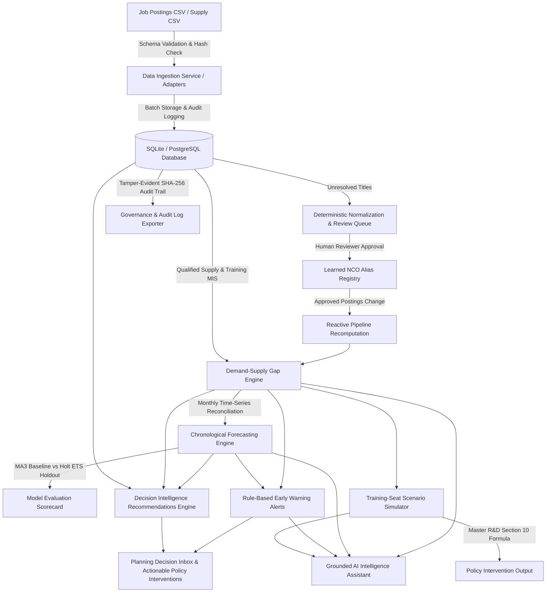

# KaryaDrishti — Labour Market Intelligence
### *See the workforce. Plan the skills. Act before the gap.*
#### AI-Enabled Labour Market Intelligence & Skill Demand-Supply Forecasting Engine

An evidence-based decision-support platform designed for state skill development missions, labour-market economists, and vocational training planners. The platform ingests employer hiring signals, normalizes job postings against the National Classification of Occupations (NCO-2015), calculates demand-supply shortages and oversupplies, projects future skill requirements using chronological forecasting, raises early-warning alerts, simulates training-seat interventions, and provides a grounded AI intelligence assistant.

---

## 1. Website Walkthrough

> **3m 56s Guided Walkthrough (`KaryaDrishti Website Walkthrough`)**  
> Demonstrates the complete end-to-end KaryaDrishti web experience—from role-based sign-in and live district/sector filtering through forecasting benchmarks, NCO-2015 normalization, training-seat policy simulation, CSV ingestion, audit exports, and the grounded AI assistant.


https://github.com/user-attachments/assets/8ca2cdd5-cc4e-4a5d-8764-4f6e160ea0e4


### What the Website Walkthrough Covers

| Step | Screen / Feature | Highlights Demonstrated |
|---|---|---|
| **1. Role-Based Entry** | **Sign-In (`Staff login` / `Public view`)** | Role-aware entry with instant demo personas: **Policy Planner**, **Training Administrator**, **Analyst**, and **Public Viewer**. |
| **2. Executive Pulse** | **Overview** | Live **API Connected** / **Baseline Mode** indicator, **District** (*All Pilot Districts*, *Pune*, *Nashik*) & **Sector** filters, KPI cards (*Demand Now*, *Qualified Supply Now*, *Projected Gap*, *Backtest Accuracy*), interactive 3/6/12-month **Holt smoothing** chart with uncertainty bands, occupation ledger, early-warning panel, and data provenance disclosures. |
| **3. Taxonomy & Mapping** | **Skills match** | **Occupation Explorer & Taxonomy Normalization** aligned to **DGE NCO-2015 (8-digit)** & **NSQF Levels 4–5**, searchable monitored occupations with click-to-open **Occupation Factsheet** drawers, and the **Review Queue** where approving a match teaches the alias registry and refreshes gaps, forecasts, and alerts automatically. |
| **4. Model Validation & Alerts** | **Forecasts** | **Chronological Holdout Benchmark Scorecard** (*3-Month Moving Average*, *Holt Linear Exponential Smoothing*, *Naïve Last Value*, *Linear Drift Baseline*, and *Candidate ARIMA* with zero-leakage holdouts and `NOT EVALUATED` transparency) plus **Early-Warning Intelligence** triage (*Acknowledge* / *Escalate for Target Review*). |
| **5. Policy Interventions** | **Scenarios** | **Evidence-Based Policy Recommendations** (*Seat Expansion*, *Curriculum Pivot*, *Apprenticeships*, *Data Audits*) with one-click **Simulate Seats →**, interactive sanction & conversion levers, **Gap Closure Trajectory** chart, live INR budget, and instructor staffing estimates. |
| **6. Lineage & Governance** | **Data & Reports** | **Source Lineage Registry**, live **FastAPI CSV Ingestion & Schema 1.0 Validator**, **Connectors & Adapters** (local CSV + planned NCS, e-Shram, NCVET/SIP specifications), and **Evidence Exports** (live CSV, District Skill Committee planning brief, and SHA-256 audit trail JSON). |
| **7. Grounded Q&A** | **AI Assistant** | Dedicated **AI Assistant** tab and floating **AI Intelligence Assistant** drawer operating as a read-only governance engine grounded strictly in occupational time series, supply estimates, capacity, and baseline forecasts. |

---

## 2. System Architecture



### Technology Stack
- **Backend**: Python 3.14 + FastAPI + SQLAlchemy + SQLite (`StaticPool` in-memory test isolation; PostgreSQL target)
- **Frontend**: React 19 + TypeScript + Vite 8 + Recharts 3 + Lucide Icons (GovSync-inspired warm parchment & terracotta editorial design system)
- **Validation**: Pydantic v2 schemas + strict CSV Schema 1.0 validator
- **Testing & Quality**: Pytest backend test suite (`backend/tests/`), ESLint, and TypeScript / Vite production build

---

## 3. Core Modules & Implemented Phases

| Phase | Capability | Key Implementation Details |
|---|---|---|
| **Phase 1** | **Data Ingestion** | Validates CSV against canonical schema 1.0 (BOM support, header integrity, date/district checks). Rejects duplicates via SHA-256 hash. Zero partial writes on validation error. |
| **Phase 2** | **NCO-2015 Normalization** | Deterministic preprocessing (lowercase, punctuation, whitespace, abbreviation expansion). Exact, alias, and token overlap matching. Human review queue with alias learning. |
| **Phase 3** | **Demand-Supply Gap Engine** | Implements Master R&D Section 8 formulas: $\text{Absolute Gap} = D - S$, $\text{Gap Rate} = \frac{D - S}{D} \times 100$. Enforces strict separation between training seats and qualified available labor. |
| **Phase 4** | **Chronological Forecasting** | Evaluates 3-month Moving Average baseline vs Holt Exponential Smoothing. Strict chronological holdout evaluation without future data leakage. Computes true MAE, RMSE, and MAPE. Dynamically expanding 80% confidence intervals. |
| **Phase 5A** | **Early-Warning Alerts** | Rule-based triage: Shortage Risk (Critical vs Warning), Oversupply Risk, Emerging Demand, and Data Quality Warning. Discloses configurable baseline default thresholds transparently. |
| **Phase 5B** | **Scenario Planner** | Implements exact Master R&D Section 10 formula: $\text{Scenario Entrants} = \text{Seats} \times \left(\frac{\text{Enrol}}{100}\right) \times \left(\frac{\text{Comp}}{100}\right) \times \left(\frac{\text{Entry}}{100}\right)$. Computes residual gap, operational budget in INR, and instructor staffing needs. |
| **Phase 6** | **Frontend Integration** | Typed API client (`apiClient.ts`), reactive live connection badge (`API Connected` / `Baseline Mode`) with latency, interactive review queue, forecast projection overlay, and live CSV upload validator. |
| **Phase 7** | **E2E Validation** | Comprehensive automated tests passing with 0 warnings/failures. Clean frontend build. Browser visual verification at desktop (1440x900) and tablet (820x1180) resolutions. |
| **Phase 8** | **Reactive Pipeline** | Automatic pipeline recomputation triggering upon human approval of normalized job titles. Updates confirmed demand observations, recalculates gaps, refreshes forecasts, and updates early warning alerts idempotently. |
| **Phase 9** | **Forecasting Reliability** | Strict monthly chronological reconciliation: resolves multi-record and synthetic-versus-imported observations without duplicate counting. Holt state-space standard errors ($\sigma_h^2 = \sigma^2 [1 + \sum_{j=1}^{h-1}(\alpha + j\alpha\beta)^2]$). Dedicated `PROJECTED_SHORTAGE_RISK` and `PROJECTED_OVERSUPPLY_RISK` alerts. Transparent `SYNTHETIC`, `IMPORTED`, and `HYBRID` provenance badges. Dynamic trade selector. |
| **Phase 10** | **Decision Intelligence** | Policy recommendation engine formulating 4 actionable intervention archetypes: Capacity Expansion, Curriculum Modernization, Apprenticeship Tie-ups, and Data Collection Audits. Integrates observed evidence with 3-month forecast trajectories and institutional training capacity. Actionable "Simulate Seats" workflow. |
| **Phase 11** | **Data Integration Readiness** | Extensible connector architecture (`BaseDataConnector`). Validated adapters for employer job postings and institutional training supply (`/api/ingestion/import-supply`). Formally specified interfaces for planned national platforms (NCS, e-Shram, NCVET/SIP) with explicit security requirements, credential isolation, and clear unverified disclosures. |
| **Phase 12** | **Governance & Explainability** | Tamper-evident SHA-256 chained audit trail (`/api/governance/audit-logs`) tracking batch imports, human reviews, and pipeline recomputations. Machine-readable explainability endpoints (`/api/governance/explainability`) documenting forecasting mathematics, gap formulas, alert triggers, and decision logic. Downloadable cryptographic audit log exports. |
| **Phase 13** | **End-to-End System Integration** | Full end-to-end workflow verification across all 13 phases. Unified occupation discovery across Overview, Skills match, and Forecasts views. Multi-source provenance disclosure, error boundary resilience, and automated regression suite. |

---

## 4. Data Provenance & Integrity Guardrails

1. **Synthetic vs Verified Data Classification**:
   - Any demonstration figures from Master R&D Section 8 (e.g. Pune Solar PV baseline demand=680, supply=420, gap rate=38.2%) are explicitly labeled `SYNTHETIC DEMO` / `SYNTHETIC BASELINE`.
   - The workspace strip continuously displays `Synthetic demonstration data · Maharashtra pilot` so planners always know when demonstration data is active.
2. **Training Capacity vs Available Supply Separation**:
   - Sanctioned training seats are treated strictly as institutional capacity. They are **never** treated as immediate qualified workers.
3. **Zero Data Leakage in Model Evaluation**:
   - Holdout evaluation strictly splits training and evaluation periods. Models are fit purely on history preceding the holdout window; under-evidenced models display `NOT EVALUATED` rather than fabricated metrics.
4. **No Unimplemented Integration Claims**:
   - The platform clearly distinguishes verified local datasets and CSV adapters from planned external government feeds (e.g. NCS, e-Shram, NCVET/SIP).

---

## 5. Local Quickstart (Windows PowerShell)

### Prerequisites
Ensure Python (>= 3.11) and Node.js (>= 18) are installed on your machine.

### First-Time Dependency Setup
```powershell
# 1. Backend virtual environment & dependencies (from repository root)
python -m venv backend\.venv
.\backend\.venv\Scripts\Activate.ps1
pip install -r backend\requirements.txt

# 2. Frontend dependencies
npm --prefix frontend install
```

### Option A: One-Command Launcher
Once dependencies are installed, launch both servers in separate PowerShell windows from the repository root:
```powershell
.\start-lmis.ps1
```

### Option B: Manual Two-Terminal Setup
**Terminal 1 — FastAPI Backend (port 8000):**
```powershell
# Run from repository root
$env:PYTHONPATH = "."
.\backend\.venv\Scripts\python.exe -m uvicorn backend.app.main:app --host 127.0.0.1 --port 8000 --reload
```
- API Docs: [http://127.0.0.1:8000/docs](http://127.0.0.1:8000/docs)
- Health Check: [http://127.0.0.1:8000/api/health](http://127.0.0.1:8000/api/health)

**Terminal 2 — Vite Frontend (port 5173):**
```powershell
cd frontend
npm run dev
```
- Web Application: [http://localhost:5173/](http://localhost:5173/)

---

## 6. Running Verification & Test Suites

```powershell
# 1. Run complete backend test suite
$env:PYTHONPATH = "."; .\backend\.venv\Scripts\pytest.exe backend/tests -v

# 2. Run frontend TypeScript linting
cmd /c "npm --prefix frontend run lint"

# 3. Run frontend production build
cmd /c "npm --prefix frontend run build"
```

---

## 7. Operational Workflow & Website Guide

### Entry: Role-Based Sign-In (`LoginPage`)
1. Open [http://localhost:5173/](http://localhost:5173/).
2. Choose **Staff login** or **Public view**, or select a one-click demo role (**Policy Planner**, **Training Administrator**, **Analyst**, or **Public Viewer**).

### Tab 1: `Overview` (Executive Pulse & Demand-Supply Trajectory)
1. **Header & Workspace Strip**: Verify the **`API Connected`** (or **`Baseline Mode`** fallback) pill, **`Synthetic demonstration data · Maharashtra pilot`** disclosure, and filter dynamically by **District** (*All Pilot Districts*, *Pune District*, *Nashik District*) and **Sector** (*All Sectors*, *Clean Tech & Solar*, *Adv. Manufacturing*, *IT & IT-Enabled Services*).
2. **KPI Cards & Forecast Chart**: Inspect *Demand Now*, *Qualified Supply Now*, *Projected Gap*, and *Backtest Accuracy*. Switch the forecast window (**3, 6, or 12 months**) or model (**Holt smoothing**, **3M Moving Average**, **Ensemble**), hover forecast points for uncertainty ranges, or click **Export CSV**.
3. **Occupation Breakdown, Early Warnings & Provenance**: Scroll to compare canonical NCO-2015 demand signals, qualified supply, separate training seats, net gaps, ranked early-warning alerts, and source-level limitations.

### Tab 2: `Skills match` (Occupation Explorer, Factsheets & Normalization Queue)
1. **Monitored Canonical Occupations**: Search by job title, alias, or NCO code, filter by sector or market status, and click any occupation row to open its full **Occupation Factsheet** drawer.
2. **Occupation Title Normalization & Review Queue**: Inspect incoming raw job postings (e.g., *Solar PV Rooftop Lead Installer*, *CNC Mechanical Plant Service Fitter*) with confidence scores and match methods (`EXACT_ALIAS`, `SEMANTIC_SUGGESTION`, `TOKEN_NORM`).
3. **Reactive Pipeline**: Click **Approve** to teach the learned NCO alias registry and trigger automatic pipeline recomputation—updating confirmed demand, gaps, forecasts, and alerts without manual intervention.

### Tab 3: `Forecasts` (Chronological Holdout Benchmark & Alert Triage)
1. **Chronological Holdout Benchmark Scorecard**: Select any target occupation/district and compare **3-Month Moving Average**, **Holt Linear Exponential Smoothing**, **Naïve Last Value**, **Linear Drift Baseline**, and **Candidate ARIMA** across strictly held-out periods (MAE, RMSE, MAPE)—with `NOT EVALUATED` displayed honestly when historical length is insufficient.
2. **Early-Warning Intelligence Feed**: Filter alerts by type, distinguish `OBSERVED EVIDENCE` (`SHORTAGE_RISK`) from `FORWARD PROJECTION` (`PROJECTED_SHORTAGE_RISK`), and **Acknowledge** or **Escalate for Target Review** with audit logging.

### Tab 4: `Scenarios` (Decision Intelligence & Policy Simulator)
1. **Evidence-Based Policy Recommendations**: Filter automated interventions (*All Recommendations*, *Seat Expansion*, *Curriculum Pivot*, *Apprenticeships*, *Data Audits*) and click **Simulate Seats →** to pre-populate the simulator.
2. **Sanction Levers & Conversion Formula (Master R&D Section 10)**: Adjust sliders for additional sanctioned seats, enrolment take-up, course completion, and target role retention to observe live updates to:
   $$\text{Scenario Entrants} = \text{Seats} \times \left(\frac{\text{Enrol}}{100}\right) \times \left(\frac{\text{Comp}}{100}\right) \times \left(\frac{\text{Entry}}{100}\right)$$
   alongside the **Backend Arithmetic Audit Trail**, **Gap Closure Trajectory** chart, residual shortage, INR operational budget, and certified trainer requirements.

### Tab 5: `Data & Reports` (Lineage, Live CSV Validator & Cryptographic Exports)
1. **Source Lineage Registry & Connectors**: Review active synthetic demonstration feeds, local CSV adapters (Job Postings, Training Supply), and planned external connectors (NCS, e-Shram, NCVET/SIP) with explicit credential and status disclosures.
2. **CSV Ingestion & Validator**: Upload or test a CSV against Schema 1.0 (`posting_id`, `raw_title`, `district_code`, `observation_date`, `vacancy_count`) for instant row-level FastAPI validation.
3. **Evidence Exports**: Download the live **Maharashtra Pilot Tabular Analysis (CSV)**, preview the **District Skill Committee Brief**, or export the tamper-evident SHA-256 chained **Ingestion & Model Lineage Audit Log (JSON)**.

### Tab 6 & Floating Drawer: `AI Assistant` (Grounded Q&A)
1. Open the **`AI Assistant`** tab or the floating **`AI Intelligence Assistant LIVE`** drawer from any screen.
2. Select a suggested inquiry (*Shortage Diagnostics*, *Time-Series Forecasting*, *Early Warning Signals*, *Skilling Interventions*) or ask natural-language questions answered strictly from the platform's data and models.

---

## 8. Operational Roadmap & Planned Integrations

- **Database**: Current deployment uses local SQLite with static thread pooling. Target production deployment will transition to PostgreSQL via SQLAlchemy.
- **Geographic Scope**: Pilot data is restricted to Maharashtra districts (Pune, Nashik). Nationwide scaling requires state-level MIS adapter pipelines.
- **Supply Sources**: Current supply estimates rely on synthetic synthesis of ITI/NCVET completions. Direct API integration with State Skill Missions (MSSDS) is designated for subsequent releases.
- **Forecast Horizon**: The 3-month statistical holdout horizon is optimized for quarterly planning cycles; longer horizons require seasonal adjustment (SARIMA/Prophet) with >= 36 months of continuous data.
