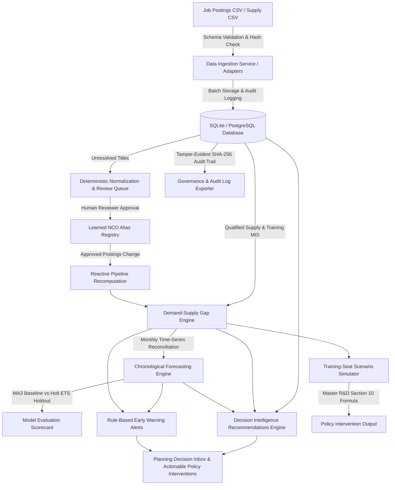

# KaryaDrishti — Labour market intelligence
### AI-Enabled Labour Market Intelligence & Skill Demand-Supply Forecasting Engine

An evidence-based decision-support platform designed for state skill development missions, labour-market economists, and vocational training planners. The platform ingests employer hiring signals, normalizes job postings against the National Classification of Occupations (NCO-2015), calculates demand-supply shortages and oversupplies, projects future skill requirements using chronological forecasting, raises early-warning alerts, and simulates training-seat interventions.

---

## 1. System Architecture



### Technology Stack
- **Backend**: Python 3.14 + FastAPI + SQLAlchemy + SQLite (`StaticPool` in-memory test isolation)
- **Frontend**: React 19 + TypeScript + Vite + Recharts + Lucide Icons (GovSync aesthetic design tokens)
- **Validation**: Pydantic v2 schemas + strict CSV schema validator
- **Testing**: Pytest (82 automated unit & integration tests) + ESLint (0 errors) + Vite production build

---

## 2. Core Modules & Implemented Phases

| Phase | Capability | Key Implementation Details |
|---|---|---|
| **Phase 1** | **Data Ingestion** | Validates CSV against canonical schema 1.0 (BOM support, header integrity, date/district checks). Rejects duplicates via SHA-256 hash. Zero partial writes on validation error. |
| **Phase 2** | **NCO-2015 Normalization** | Deterministic preprocessing (lowercase, punctuation, whitespace, abbreviation expansion). Exact, alias, and token overlap matching. Human review queue with alias learning. |
| **Phase 3** | **Demand-Supply Gap Engine** | Implements Master R&D Section 8 formulas: $\text{Absolute Gap} = D - S$, $\text{Gap Rate} = \frac{D - S}{D} \times 100$. Enforces strict separation between training seats and qualified available labor. |
| **Phase 4** | **Chronological Forecasting** | Evaluates 3-month Moving Average baseline vs Holt Exponential Smoothing. Strict chronological holdout evaluation without future data leakage. Computes true MAE, RMSE, and MAPE. Dynamically expanding 80% confidence intervals. |
| **Phase 5A** | **Early-Warning Alerts** | Rule-based triage: Shortage Risk (Critical vs Warning), Oversupply Risk, Emerging Demand, and Data Quality Warning. Discloses configurable baseline default thresholds transparently. |
| **Phase 5B** | **Scenario Planner** | Implements exact Master R&D Section 10 formula: $\text{Scenario Entrants} = \text{Seats} \times \left(\frac{\text{Enrol}}{100}\right) \times \left(\frac{\text{Comp}}{100}\right) \times \left(\frac{\text{Entry}}{100}\right)$. Computes residual gap, operational budget in INR, and instructor staffing needs. |
| **Phase 6** | **Frontend Integration** | Typed API client (`apiClient.ts`), reactive live connection badge with latency in masthead, interactive review queue, forecast projection overlay, and live CSV upload validator. |
| **Phase 7** | **E2E Validation** | Comprehensive automated tests passing with 0 warnings/failures. Clean frontend build. Browser visual verification at desktop (1440x900) and tablet (820x1180) resolutions. |
| **Phase 8** | **Reactive Pipeline** | Automatic pipeline recomputation triggering upon human approval of normalized job titles. Updates confirmed demand observations, recalculates gaps, refreshes forecasts, and updates early warning alerts idempotently. |
| **Phase 9** | **Forecasting Reliability** | Strict monthly chronological reconciliation: resolves multi-record and synthetic-versus-imported observations without duplicate counting. Holt state-space standard errors ($\sigma_h^2 = \sigma^2 [1 + \sum_{j=1}^{h-1}(\alpha + j\alpha\beta)^2]$). Dedicated `PROJECTED_SHORTAGE_RISK` and `PROJECTED_OVERSUPPLY_RISK` alerts. Transparent `SYNTHETIC`, `IMPORTED`, and `HYBRID` provenance badges. Dynamic trade selector. |
| **Phase 10** | **Decision Intelligence** | Policy recommendation engine formulating 4 actionable intervention archetypes: Capacity Expansion, Curriculum Modernization, Apprenticeship Tie-ups, and Data Collection Audits. Integrates observed evidence with 3-month forecast trajectories and institutional training capacity. Actionable "Simulate Seats" workflow. |
| **Phase 11** | **Data Integration Readiness** | Extensible connector architecture (`BaseDataConnector`). Validated adapters for employer job postings and institutional training supply (`/api/ingestion/import-supply`). Formally specified interfaces for planned national platforms (NCS, e-Shram, NCVET/SIP) with explicit security requirements, credential isolation, and clear unverified disclosures. |
| **Phase 12** | **Governance & Explainability** | Tamper-evident SHA-256 chained audit trail (`/api/governance/audit-logs`) tracking batch imports, human reviews, and pipeline recomputations. Machine-readable explainability endpoints (`/api/governance/explainability`) documenting forecasting mathematics, gap formulas, alert triggers, and decision logic. Downloadable cryptographic audit log exports. |
| **Phase 13** | **End-to-End System Integration** | Full end-to-end workflow verification across all 13 phases. Unified occupation discovery across Overview, Explorer, and Forecasting views. Multi-source provenance disclosure, error boundary resilience, and automated regression suite (99 backend tests, 0 ESLint errors, clean production bundle). |

---

## 3. Data Provenance & Integrity Guardrails

1. **Synthetic vs Verified Data Classification**:
   - Any demonstration figures from Master R&D Section 8 (e.g. Pune Solar PV demand=680, supply=420, gap rate=38.2%) are explicitly labeled `SYNTHETIC_DEMO`.
   - The UI displays an unmissable top amber banner whenever synthetic or demo data is being viewed.
2. **Training Capacity vs Available Supply Separation**:
   - Sanctioned training seats are treated strictly as institutional capacity. They are **never** treated as immediate qualified workers.
3. **Zero Data Leakage in Model Evaluation**:
   - Holdout evaluation strictly splits training and evaluation periods. Models are fit purely on history preceding the holdout window.
4. **No Unimplemented Integration Claims**:
   - The platform clearly distinguishes verified local datasets from hypothetical external live feeds (e.g. NCS, Skill India Digital).

---

## 4. Local Quickstart (Windows PowerShell)

### Step 1: Clone & Prerequisites
Ensure Python (>= 3.11) and Node.js (>= 18) are installed on your machine.

### Step 2: Start the FastAPI Backend
Open a PowerShell terminal in the repository root:
```powershell
# Navigate to backend directory
cd backend

# Create and activate virtual environment
python -m venv .venv
.\.venv\Scripts\Activate.ps1

# Install dependencies
pip install -r requirements.txt

# Run backend development server (port 8000)
python -m uvicorn app.main:app --host 127.0.0.1 --port 8000 --reload
```
- API Docs: [http://127.0.0.1:8000/docs](http://127.0.0.1:8000/docs)
- Health Check: [http://127.0.0.1:8000/api/health](http://127.0.0.1:8000/api/health)

### Step 3: Start the Vite Frontend
Open a second PowerShell terminal in the repository root:
```powershell
# Navigate to frontend directory
cd frontend

# Install dependencies
npm install

# Run frontend development server (port 5173)
npm run dev
```
- Web Application: [http://localhost:5173/](http://localhost:5173/)

---

## 5. Running Verification & Test Suites

```powershell
# 1. Run complete backend test suite (82 tests)
$env:PYTHONPATH=".."; .\backend\.venv\Scripts\pytest.exe backend/tests -v

# 2. Run frontend TypeScript linting
cmd /c "npm --prefix frontend run lint"

# 3. Run frontend production build
cmd /c "npm --prefix frontend run build"
```

---

## 6. Operational Workflow & System Walkthrough

### Act 1: The Problem & High-Level Evidence (Screen 1: Overview)
1. **Open [http://localhost:5173/](http://localhost:5173/)**.
2. **Highlight the Masthead**: Point out the green `FASTAPI LIVE` status badge showing active backend connection and millisecond latency.
3. **Show Data Integrity Banner**: Point out the top amber banner informing government planners that demonstration pilot records are active with synthetic/hybrid provenance tags.
4. **Inspect KPI Grid & Gap Ledger**:
   - Select district **Pune (MH_PUN)**.
   - Show the primary pilot trade: **Solar PV Installation & Maintenance Technician (NCO 7421.0301)**.
   - Demand: 680 postings | Qualified Supply: 420 completers | Absolute Shortage: +260 | Gap Rate: 38.2%.
   - Show that sanctioned seats (450) and enrolled trainees (410) are tracked separately from qualified supply.

### Act 2: Ingestion, Normalization & Reactive Recomputation (Screen 2: Occupation Explorer)
1. **Navigate to 'Occupation Explorer'**.
2. **Review NCO-2015 Standards**: Search `Solar` or `Welder` to view canonical NCO codes and registered aliases.
3. **Human Review Queue & Reactive Pipeline**:
   - Review pending job postings (e.g. `Solar Rooftop Technician` or `Lead CNC Programmer`) pre-matched with confidence scores.
   - Click **Approve**. Explain that approval writes to the learned alias registry **and immediately recomputes the intelligence pipeline** (updating confirmed demand, gaps, forecasts, alerts, and recommendations without manual intervention).

### Act 3: Chronological Forecasting & Alerts (Screen 3: Forecast & Alerts)
1. **Navigate to 'Forecast & Alerts'**.
2. **Inspect Model Evaluation Scorecard**:
   - Compare the **3-Month Moving Average Baseline** against the **Candidate Holt Exponential Smoothing Model**.
   - Review holdout metrics: MAE, RMSE, and MAPE under strict chronological validation.
3. **Inspect Forecast Chart & Provenance Badges**:
   - Show historical demand points transitioning into the 3-month forecast window with expanding 80% confidence interval bands calculated via state-space variance.
   - Select newly imported or synthetic trades via the dynamic dropdown.
4. **Inspect Early-Warning Decision Inbox**:
   - Note the distinction between observed shortage alerts and **Projected Shortage Risk** alerts raised from forecast trajectories.

### Act 4: Policy Simulator & Decision Intelligence (Screen 4: Scenario Planner)
1. **Navigate to 'Scenario Planner'**.
2. **Review Decision Intelligence Shelf**:
   - Inspect automated policy recommendations (Capacity Expansion, Curriculum Modernization, Apprenticeship Tie-up, Data Collection Audit).
   - Click **"Simulate Seats"** on a recommendation card to automatically populate the simulator with recommended intervention targets.
3. **Test Master R&D Section 10 Conversion Formula**:
   - Watch the live calculated output:
     $$\text{Scenario Entrants} = \text{Seats} \times \left(\frac{\text{Enrol}}{100}\right) \times \left(\frac{\text{Comp}}{100}\right) \times \left(\frac{\text{Entry}}{100}\right)$$
   - Review residual shortage, operational budget in INR, and instructor staffing ratios.

### Act 5: Governance, Connectors & Cryptographic Audit (Screen 5: Data & Reports)
1. **Navigate to 'Data & Reports'**.
2. **Inspect Connectors & Adapters**:
   - View supported local CSV adapters (Job Postings, Institutional Training Supply).
   - Inspect planned external connectors (NCS, e-Shram, NCVET/SIP) with transparent disclosures of required credentials and inactive live status.
3. **Download Cryptographic Audit Trail**:
   - Click **"Download Audit Trail (JSON)"** to export SHA-256 chained governance records verifying ingestion batches, human approvals, and model updates.

---

## 7. Operational Roadmap & Planned Integrations

- **Database**: Current deployment uses local SQLite with static thread pooling. Target production deployment will transition to PostgreSQL via SQLAlchemy.
- **Geographic Scope**: Pilot data is restricted to Maharashtra districts (Pune, Nashik). Nationwide scaling requires state-level MIS adapter pipelines.
- **Supply Sources**: Current supply estimates rely on synthetic synthesis of ITI/NCVET completions. Direct API integration with State Skill Missions (MSSDS) is designated for subsequent releases.
- **Forecast Horizon**: The 3-month horizon is optimized for quarterly planning cycles; longer horizons require seasonal adjustment (SARIMA/Prophet) with >= 36 months of continuous data.
